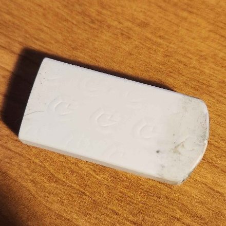

<p align="center">
  
</p>

<h1 align="center">🪄 Efface Magique LR</h1>

<p align="center">
  <b>Free, Private, and 100% Local AI Generative Eraser for Adobe Lightroom Classic</b><br>
  <i>Runs entirely on your machine. Zero cloud subscriptions, zero data leaks, zero monthly costs.</i>
</p>

[](https://github.com/LLiu223/efface-magique-lr/actions/workflows/ci.yml)

<p align="center">
  <a href="#-easy-download-for-other-users"></a>
  <a href="#-quick-installation"></a>
  <a href="#-how-to-use"></a>
  
</p>

---

## 🌟 Overview

**Erase tourists, power lines and dust from Lightroom Classic photos with local LaMa inpainting. Nothing leaves your machine.**

### Features
- **✨ LaMa Variations:** LaMa inpainting with 3 slightly different seeded candidates to pick from. The optional prompt only adds a deterministic colour tint of a few levels.
- **⚡ Fast Spot Removal:** a single LaMa pass for dust, blemishes and thin wires.
- **🎯 Object-Aware Erasing (Subject):** the subject detector tightens a rough brush mask to the object's contour inside the painted zone.
- **📚 Non-Destructive Modification Layers:** every erase is a layer in the sidebar. Toggle it, re-edit its mask, or delete it with its `✕` button.
- **⚡ Live Window:** stays open while you browse photos in Lightroom. Save & Sync stacks the edit above the original in your catalog.
- **🎨 Color & bit depth:** keeps the ICC profile and DPI. A 16-bit TIFF from Lightroom is saved as a 16-bit TIFF in which only the erased pixels change (they are computed in 8-bit). EXIF is not rewritten.
- **🔒 Local only:** the plugin and companion talk over an HTTP bridge on `127.0.0.1`, with no cloud calls. See [SECURITY.md](SECURITY.md) for what it does and does not protect against.

### How it works
The Lightroom plugin (`LiveBridge.lua`) waits for the selection to settle (80 ms debounce), exports the photo as a 16-bit ProPhoto TIFF into `.tmp/`, and sends its path to the companion app over `127.0.0.1:51739`. You erase in the companion. **Save & Sync** writes the result and queues it, and the plugin, polling about every 300 ms, copies the file next to the original and stacks it above it in your catalog. Threads, hand-off files and shutdown are covered in [docs/architecture.md](docs/architecture.md).

### Install & run
1. Run `install.bat` (Windows) or `./install.sh` (macOS / Linux) to create `.venv` with PyTorch and Simple-LaMa. See [Quick Installation](#-quick-installation).
2. In Lightroom Classic, open **File > Plug-in Manager... > Add** and select `plugin/ai_eraser.lrplugin`.
3. Select a photo and choose **File > Plug-in Extras > ⚡ AI Generative Eraser (Live Window)...**.
4. Paint over the object, press `Enter`, pick a variation, then press `Ctrl + S` to save and stack it in Lightroom.

To use it without Lightroom, run `companion.bat` / `./companion.sh`.

<!-- BEFORE/AFTER IMAGE: side-by-side crop of a photo before and after erasing (add the file under docs/ first, then link it here) -->

<!-- DEMO GIF: screen recording of selecting a photo in Lightroom, erasing in the Live Window, and the edit stacking in the catalog (add the file under docs/ first, then link it here) -->

---

## 📥 Easy Download for Other Users

You do **not** need Git or programming experience to install and use Efface Magique LR:

### Option 1: Download Pre-Packaged Release (Recommended for Most Users)
1. Download **`Efface-Magique-LR.zip`** from the [GitHub Releases](https://github.com/LLiu223/efface-magique-lr/releases) page or from your shared team drive.
2. Extract the ZIP file anywhere on your computer (e.g., `Documents` or `C:\Tools\Efface-Magique-LR`).
3. Follow the **[Quick Installation](#-quick-installation)** steps below.

### Option 2: Build a Distribution ZIP to Share with Friends
If you already have this repository cloned, you can create a clean, portable distribution package to share:
- **Windows:** Double-click `package_release.bat` in the project root.
- **In-App:** Open the app, click **💡 Help & Guide** in the toolbar, switch to the **📥 Download & Share** tab, and click **📦 Package Distribution ZIP**.
- **Terminal:** Run `python package_release.py`.

The clean archive is created in `dist/Efface-Magique-LR.zip` and automatically revealed in File Explorer!

---

## 🚀 Quick Installation

### Step 1: Install Dependencies (1-Click)

Run the automated installer inside the project directory:

- **Windows:** Double-click `install.bat` (or run `install.bat` in Command Prompt / PowerShell).
- **macOS / Linux:** Open Terminal in the project folder and run:
  ```bash
  chmod +x install.sh && ./install.sh
  ```

*The installer automatically configures a dedicated Python virtual environment (`.venv`) with PyTorch, Simple-LaMa, and all required AI libraries.*

---

### Step 2: Add the Plugin to Adobe Lightroom Classic

1. Open **Adobe Lightroom Classic**.
2. Open the **Plug-in Manager**:
   - Menu: **File > Plug-in Manager...**
   - Shortcut: `Ctrl + Alt + Shift + ,` (Windows) or `Cmd + Opt + Shift + ,` (macOS).
3. Click the **Add** button in the bottom-left corner of the dialog.
4. Browse to the project folder and select:
   ```
   efface-magique-lr/plugin/ai_eraser.lrplugin
   ```
5. Confirm that the status indicator shows **🟢 Installed and running**.
6. Click **Done**. The plugin is now permanently enabled across all your Lightroom catalogs!

---

## ✨ How to Use

### ⚡ Mode 1: Seamless Live Window Sync (Recommended)

Work through your entire photoshoot without ever relaunching or closing the editor:

1. In Lightroom Classic, select any photo and choose:  
   **File > Plug-in Extras > ⚡ AI Generative Eraser (Live Window)...**
2. The companion window opens, automatically loading your active photo.
3. **Keep the window open:** As you browse through photos in Lightroom using your arrow keys or the Filmstrip, the companion window follows along: about 80 ms after the selection settles, Lightroom exports a full TIFF and the companion loads it (recent exports are cached).
4. **Erase unwanted elements:** Paint over tourists, power poles, or dust spots with the red brush. Use `[` and `]` to adjust the brush diameter.
5. **Smart Object Selection (🎯 Subject):** Toggle **Subject** to automatically isolate and snap to the object's boundary. Our multi-cluster local background sampling and adaptive edge saliency preserve thin posts, eaves, and rooflines on distant/small structures so no wireframe outlines remain.
6. **Generate Inpainting:** Click **✨ Erase Object** (or press `Enter`).
7. **Pick a Variation:** Efface Magique generates distinct candidate variations. Click any thumbnail card or press `1`, `2`, or `3` to select your favorite.
8. **Manage Modification Layers:** Inspect each modification in the sidebar:
   - Click the checkmark (`✓`) to toggle a layer's visibility on/off.
   - Click the delete button (`✕`) on any card to permanently delete that layer with automatic, clean re-compositing.
   - Click any card to re-enter edit mode and refine its mask.
9. **Save & Sync:** Click **⚡ Save & Sync to Lightroom** (or press `Ctrl + S`).  
   - Lightroom exports a 16-bit ProPhoto TIFF; untouched pixels keep full 16-bit precision; the erased area is computed in 8-bit and merged back; preview is 8-bit. The saved TIFF is 16-bit.
   - Lightroom automatically imports and stacks the edited version with the original photo.
   - The companion window **stays open**, ready for your next photo!
10. **Stay Floating:** Click **📌 Pin** (or press `Ctrl + T`) to keep the editor floating smoothly above Lightroom.

---

### 🧪 Mode 2: Standalone Desktop App (Without Lightroom)

You can also use Efface Magique as a standalone desktop photo eraser:
- **Windows:** Double-click `companion.bat`.
- **macOS / Linux:** Run `./companion.sh`.
- Click **📂 Open** in the toolbar to load any JPG, PNG, TIFF, or WebP photo.

---

## ⌨ Keyboard Shortcuts

| Shortcut | Action | Description |
| :--- | :--- | :--- |
| **`Ctrl + S`** / **`Ctrl + Shift + S`** | **⚡ Save & Sync to Lightroom** | Saves TIFF (16-bit for a 16-bit input), auto-stacks into Lightroom catalog, and stays open |
| **`Enter`** / **`Return`** | **✨ Erase Object** | Runs local AI inpainting on painted mask |
| **`Ctrl + T`** | **📌 Toggle Pin** | Keeps window floating always on top of Lightroom Classic |
| **`[` / `]`** | **Brush Size** | Decrease / Increase brush radius |
| **`Ctrl + Z`** | **↶ Undo** | Undo stroke or inpainting action |
| **`Ctrl + Y`** / **`Ctrl + Shift + Z`** | **↷ Redo** | Redo stroke or inpainting action |
| **`Spacebar` (Hold)** / **`\`** | **👁 Compare Before / After** | Temporarily displays original photo for instant comparison |
| **`Y`** | **◫ Split Screen Slider** | Interactive before/after split-screen wiper |
| **`Ctrl + 0`** / **`F`** | **🔍 Fit to Screen** | Resets zoom to fit image viewport |
| **`Ctrl + 1`** | **100% 1:1 View** | Zooms to 100% true pixel scale |
| **`Middle Mouse Drag`** | **Pan Viewport** | Smooth canvas panning |
| **`Mouse Scroll Wheel`** | **Zoom** | Smooth zooming centered at cursor position |
| **`F1`** | **💡 Help & Guide** | Opens interactive in-app guide, shortcuts, and distribution packager |

---

## 🧠 Technology & Engine Modes

| Engine Mode | Technology | Best For |
| :--- | :--- | :--- |
| **✨ LaMa Variations** *(Default)* | LaMa inpainting with slight seeded variations, noise matching & contextual cropping | Complex object removal, people, background reconstruction, texture synthesis |
| **⚡ Fast Spot Removal** | Fast Fourier GAN (Simple-LaMa) | Small spots, sensor dust, blemishes, thin power wires |

### Inpainting Models (registry)
The pipeline (crop, dilation, grain, feather blend, layers) is independent of the network that fills the hole.
That network is an `InpaintModel` (`companion/models/base.py`) looked up by name in
`companion/models/registry.py`; LaMa (`companion/models/lama.py`, name `"lama"`) is the first and default entry.
The **Model** dropdown next to the Fast/Generative dropdown lists every registered model (unavailable ones are
greyed out with a tooltip); the choice is saved in `QSettings` (`model/name`) and restored at startup (unknown or
unavailable names fall back to `lama`). `InpaintingEngine.set_model(name)` unloads the old model and frees device
memory under the load lock before the new one loads lazily, so only one model is ever resident in VRAM.
The dropdown is locked while an erase runs. The bridge accepts an optional `"model"` string in `POST /api/select`
(absent keeps the current choice; non-string, unknown or unavailable names get `400 {"error": ...}`).

How to add a model:
```python
# companion/models/my_model.py, then add `from companion.models import my_model` to companion/models/__init__.py
import importlib.util
from PIL import Image
from companion.models.base import InpaintModel
from companion.models.registry import register

@register
class MyModel(InpaintModel):
    name = "my_model"          # stable id (settings, bridge)
    label = "My Model"         # dropdown text
    uses_prompt = False
    steps = None

    @classmethod
    def is_available(cls):     # cheap check only: never load weights here
        return importlib.util.find_spec("my_model_pkg") is not None

    def load(self, device, progress_callback=None):
        import my_model_pkg    # lazy import keeps startup fast
        self._net = my_model_pkg.load(device)

    def unload(self):
        self._net = None       # drop references; the engine then frees device memory

    def inpaint(self, crop, mask, seed, prompt):
        return self._net(crop, mask).convert("RGB").resize(crop.size, Image.Resampling.LANCZOS)
```

### Color & Photographic Quality
- **Color Profile Preservation:** ProPhoto RGB and Adobe RGB ICC profiles and DPI are kept on save (EXIF is not rewritten).
- **16-bit TIFF Round Trip:** For a 16-bit RGB TIFF saved as TIFF, untouched pixels keep full 16-bit precision; the erased area is computed in 8-bit and merged back; preview is 8-bit. 8-bit inputs and PNG/JPEG output stay 8-bit.
- **Sensor Noise Matching:** Automatically estimates camera ISO noise in the surrounding area and injects monochromatic grain to eliminate plastic-looking patches.
- **Sigmoid Alpha Blending:** High-resolution feathering with zero pixel blur on untouched regions.
- **Object-Aware Saliency Engine:** Multi-cluster local background sampling in CIE-Lab, CLAHE Sobel gradient energy, adaptive Otsu bimodal segmentation, solid contour hole-filling, and proportional safety margins.
- **Non-Destructive Layer Architecture:** In-memory composite caching, per-layer modification history, instant toggle/delete re-compositing.

---

## 🛠 Troubleshooting & FAQ

- **"Python not found" or plugin fails to start:**  
  Make sure you completed Step 1 by running `install.bat` (Windows) or `./install.sh` (macOS/Linux). The plugin automatically searches for `.venv\Scripts\python.exe` inside the project folder.
- **GPU Acceleration:**  
  Efface Magique automatically detects and leverages NVIDIA CUDA GPUs on Windows/Linux and Apple Silicon Metal Performance Shaders (MPS) on macOS. On systems without a dedicated GPU, it automatically falls back to optimized multi-threaded CPU processing.
- **Lightroom Plugin Status:**  
  If the plugin shows a red dot in Plug-in Manager, select it, click **Disable**, and then click **Enable**.

---

### Assistant (optional, `companion/agent/`)
Type a request such as "remove the person on the left" in the **Assistant** box in the top bar and press **Ask**.
A LangChain agent (`langchain.agents.create_agent`) works only through five tools and never replaces the engine:

```
Assistant box -> AgentWorker (QThread, harness.py: max steps / token budget / timeout / cancel / allow-list / 1 retry)
              -> tools.py: list_models, select_model, set_prompt, detect_regions, inpaint_region
              -> registry.get + InpaintingEngine.set_model / get_segmentation_model / InpaintingEngine.generate_variations
              -> proposal preview -> user clicks Apply -> the normal Erase layer path (_on_inpainting_finished)
```

- Install with `pip install -r requirements-agent.txt` (pinned versions; `requirements.txt` is unchanged). Without
  it the app runs as before and the assistant fields are disabled with the tooltip "install requirements-agent.txt".
- Providers: `ollama` (default, `http://localhost:11434`), `anthropic`, `openai`, `gemini`. Keys are read only from
  `ANTHROPIC_API_KEY`, `OPENAI_API_KEY`, `GOOGLE_API_KEY`; they are never written to settings, logs or the usage DB.
- `detect_regions` can only locate the 20 VOC classes of the segmentation weights (person, car, bottle, dog, chair...),
  so "remove the bin" usually ends with "nothing matching was found"; paint over such objects by hand.
- Nothing is added to the layers until you click **Apply**; **Discard** drops the preview, **Stop** cancels.
- **Usage** opens the usage log (SQLite in the app data folder: tokens, latency, estimated cost per call, CSV export,
  Clear) and the assistant settings (Ollama URL, token budget, opt-in "store prompt text").
- **Privacy:** images are never sent to an LLM in v1, nor are file names or EXIF; only your request text, the model
  list and region labels/positions. Ollama on localhost keeps that text on this computer (a non-localhost Ollama URL
  shows a warning). Anthropic, OpenAI and Gemini are cloud services: the text and region labels leave the device.
  LangSmith tracing is always off for assistant requests, even if `LANGSMITH_TRACING` or `LANGCHAIN_TRACING_V2` is set.

## 📁 Repository Structure

```
efface-magique-lr/
├── package_release.bat               # 1-Click script to package distribution ZIP
├── package_release.py                # Release packager (excludes caches/.venv)
├── install.bat                       # Automated Windows installer
├── install.sh                        # Automated macOS/Linux installer
├── companion.bat                     # Windows launcher for companion app
├── companion.sh                      # Unix launcher for companion app
├── requirements.txt                  # Python dependencies
├── requirements-agent.txt            # Optional assistant (LangChain) dependencies, pinned
├── README.md                         # Documentation & user guide
├── SECURITY.md                       # Bridge threat model & vulnerability reporting
├── CHANGELOG.md                      # Release notes (Keep a Changelog)
│
├── docs/
│   └── architecture.md               # Data flow, threading model, hand-off files
│
├── plugin/
│   └── ai_eraser.lrplugin/           # Adobe Lightroom Classic Plugin
│       ├── Info.lua                  # Plugin manifest, menu hooks, & hotkeys
│       ├── LiveBridge.lua            # High-speed background IPC bridge for Live Window
│       ├── JsonUtil.lua              # Pure JSON helpers (no Lightroom SDK, unit-testable)
│       ├── PluginUtils.lua           # Environment detection & CLI launcher
│       └── logo.png                  # Plugin branding icon
│
├── companion/                        # Python AI Companion Application
│   ├── app.py                        # PyQt6 Main Window, toolbar, & layer cards
│   ├── canvas.py                     # High-res canvas with brush, zoom, & pan
│   ├── layers.py                     # Non-destructive layer model & thumbnails
│   ├── model_engine.py               # Inpainting engine around the active model (Generative AI variations & Fast)
│   ├── models/                       # InpaintModel interface, registry, LaMa (default model)
│   ├── pipeline.py                   # Contextual cropping, blending, & grain matching
│   ├── live_bridge.py                # Localhost (127.0.0.1) HTTP bridge server
│   ├── utils/
│   │   ├── subject_detector.py       # Multi-cluster object-aware subject isolation
│   │   └── tiff16.py                 # Lossless 16-bit RGB TIFF read/write & merge
│   └── assets/                       # Branding logos & UI icons
│       ├── logo.png                  # 440x440 App logo
│       ├── logo.ico                  # Multi-resolution Windows application icon
│       └── checkmark.png             # Crisp checkbox checkmark icon
│
└── tests/                            # Automated test suite (150+ unit/integration tests)
    └── lua/
        └── test_json_util.lua        # Plain-Lua tests for JsonUtil.lua
```

---

## 🧪 Running Tests

```bash
python run_tests.py
```

The Lua tests in `tests/lua/` need a plain `lua` or `luajit` interpreter on your `PATH`; the Python test suite runs them when one is found.

The assistant tests (`tests/test_agent_*.py`) use a scripted fake chat model (no network, no keys) and skip when
`requirements-agent.txt` is not installed. To run the whole suite as if it were not installed:
`PYTHONPATH=tests python -m pytest -p agent_blocker tests -q`.

---

## 📄 License

Efface Magique LR is licensed under the **MIT License**. Free for personal and commercial photography workflows.
