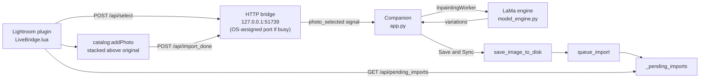

# Architecture

Efface Magique LR has two parts that talk over a localhost HTTP bridge:

- **Lightroom plugin** (`plugin/ai_eraser.lrplugin/`): `LiveBridge.lua` watches the selected photo, exports it, and imports finished edits. `PluginUtils.lua` finds Python, the project root and the bridge port. `JsonUtil.lua` holds the pure-Lua JSON helpers (`jsonEscape`, `parsePendingImports`), which have no Lightroom SDK dependency, so a plain Lua 5.1 interpreter can test them.
- **Companion app** (`companion/`): a PyQt6 window (`app.py`) that runs the HTTP bridge (`live_bridge.py`) and the LaMa engine (`model_engine.py`), and saves the result (`save_image_to_disk`).

## Data flow

1. The user starts **File > Plug-in Extras > AI Generative Eraser (Live Window)**. `LiveBridge.lua` pings `/api/ping`. If nothing answers with `EffaceMagique`, it launches `companion/app.py --live` as a detached process and pings again every 0.4 s, up to 25 times. It then POSTs `/api/focus`.
2. The companion binds `127.0.0.1:51739` (`DEFAULT_BRIDGE_PORT`). If that port is busy it binds port 0 and the OS picks one.
3. When the selection settles, on a cache miss the plugin first asks Lightroom's preview cache for a JPEG (`requestJpegThumbnail`, 2048 px box), waits at most 300 ms for it, writes it to `.tmp/preview_<localIdentifier>.jpg` and POSTs `/api/preview` with `path` and `photo_id`. The companion shows it as a read-only placeholder ("Loading full resolution…"). Then the plugin exports the photo to `.tmp/live_<localIdentifier>.tif` exactly as before, times the export and POSTs `/api/select` with `path`, `photo_id`, `original_path`, `title` and `export_ms`. A cache hit skips the preview and sends `export_ms: 0`. If the export produces no file after a preview was posted, the plugin POSTs `/api/preview` with `{"photo_id", "export_failed": true}`.
4. The companion loads the TIFF. Erasing runs `InpaintingEngine.generate_variations` on a background `InpaintingWorker` thread: 3 seeded LaMa variations in "Generative AI" mode, or 1 pass in "Fast Spot Removal" mode.
5. **Save & Sync** (`Ctrl+S`) calls `save_image_to_disk`, then `LiveBridgeServer.queue_import(path, original_path, photo_id)`.
6. The plugin polls `/api/pending_imports`, copies the file next to the original, calls `catalog:addPhoto(path, original, 'above')` inside `withWriteAccessDo` (stacked above the original), selects the new photo and POSTs `/api/import_done`.

## Threading model

### Companion (Python)

| Thread | Created in | What runs there |
| :--- | :--- | :--- |
| Qt UI / main thread | `main()` -> `QApplication.exec()` | All widgets, canvas, layer stack, `load_image_file`, `save_image_to_disk`, every slot connected to bridge and worker signals |
| `InpaintingWorker` (`QThread`) | `MainWindow._start_inpainting_pipeline` | `engine.generate_variations(...)`. Emits `progress(int, str)`, `variationsReady(list)`, `error(str)`, and the built-in `finished` |
| HTTP `serve_forever` (daemon `threading.Thread`) | `LiveBridgeServer.start` | Accept loop of `ThreadedHTTPServer` |
| One daemon thread per request | `ThreadingMixIn` with `daemon_threads = True` | `LiveBridgeRequestHandler.do_GET` / `do_POST` |
| Engine pre-warm (daemon `threading.Thread`) | `MainWindow.__init__` | `_prewarm_engine` -> `engine.load_model()` |

Rules the code follows:

- **Signals carry bridge events to the UI.** `LiveBridgeServer` is a `QObject` with `photo_selected(dict)`, `photo_previewed(dict)`, `focus_requested()`, `import_completed(dict)` and `close_requested()`. The request threads emit them. The receivers are `MainWindow` slots, and the main thread owns `MainWindow`, so Qt's default `AutoConnection` delivers them as queued calls on the UI thread. Request threads never touch widgets.
- **`_pending_imports` is the only cross-thread queue.** It is a plain `list` guarded by a `threading.Lock`. `queue_import` (UI thread) appends to it and skips duplicate paths. `get_pending_imports` (request thread) returns a copy. `remove_pending_import` (request thread, on `/api/import_done`) filters it.
- `active_image_path` is a plain attribute that `/api/select` writes and `/api/ping` reads. Nothing else depends on it.
- `InpaintingEngine.load_model` holds an instance `threading.Lock` and checks `_is_loaded` twice, so the pre-warm thread and a first erase never build SimpleLama twice.
- **The worker lifecycle is serialized.** While `self.worker` is set, a live selection is not applied. It is stored in `_pending_select` and replayed from `_on_worker_thread_finished`. While the "discard unsynced layers?" prompt is open, newer selections replace `_pending_select` instead of opening another prompt.
- **Preview state.** `_on_live_photo_previewed` ignores a preview (and logs why) when the current photo has unsynced layers, a prompt is open, a worker runs, or the photo is already loaded. Otherwise it draws the JPEG over the canvas (`ImageCanvas.set_placeholder`, fit to the viewport, aspect kept) and sets `_preview`. The loaded photo, its layers, paths, recovery and autosave state are not touched. While `_preview` is set, Open, Erase, Save & Sync, Undo/Redo/Reset, the layers panel, the variations carousel and the assistant are disabled, their handlers return early (`_preview_blocks`), and the canvas refuses painting and its key shortcuts. Any `/api/select` ends the preview first (`_end_preview`), then loads the full file as before or, for the photo already loaded, simply shows it again. A newer preview replaces an older one. If no select arrives within `CONFIG.PREVIEW_TIMEOUT_MS` (30 s), or the plugin reports `export_failed`, the companion drops the preview and stays on the previously loaded photo. Because a preview is never shown over unsynced layers, the discard prompt still comes with the full select, and "No" keeps everything as it was.
- **Timing log (INFO).** `preview shown photo_id=… (+N ms after receipt)` and `full loaded photo_id=… load_ms=… export_ms=… since_preview_ms=…`.
- **Assistant region detection.** `AgentSession.detect_regions(query)` runs on the `AgentWorker` thread. With a query and the Precise selection models present it uses them (below); without a query, or when they are missing or fail, the VOC LRASPP model runs as before and the result carries a note saying why ("install the optional Precise selection step (install.bat)" or "Precise selection failed").
- **Precise selection pipeline (job 023).** `companion/utils/precise_models.py` holds three `LocalModel` loaders (`WEIGHT_SUBDIR`, `WEIGHT_FILES`, `is_available()`, lazy cached `get()`, `status()`, failure logged once and cached, `local_files_only=True`, CUDA when available): `GROUNDING_DINO` (`models/grounding_dino/`, ~690 MB, fp32), `SAM2` (`models/sam2/`, ~185 MB, fp16 on CUDA) and `VITMATTE` (`models/vitmatte/`, ~105 MB, fp32). All are installed by one optional install.bat step (pinned HF revisions, SHA256 per file, about 980 MB). `detect_regions` runs, per stage with a fallback:
  1. **Find.** With a query and both Grounding DINO and SAM 2 present: Grounding DINO on the whole photo at its own input size (`GDINO_INPUT_DIM` 1333 px long side), plus, on photos larger than `GDINO_TILE` (2666 px), overlapping 2666 px tiles (25 % overlap) so small objects get enough pixels; tile boxes cut by a tile's inner edge are dropped (the whole view or a neighbour has that object), with text `query.lower() + "."`, `GDINO_BOX_THRESHOLD` 0.35 / `GDINO_TEXT_THRESHOLD` 0.25 (model card defaults), duplicate boxes across views merged by NMS at IoU 0.7; outlines down to `MIN_OUTLINE_SHARE` (0.01 % of the frame) are kept; one region per box, `session.detector = "grounding_dino"`. Otherwise (or when this stage raises) the VOC classes, with a note.
  2. **Outline.** SAM 2 on a crop of the full-resolution photo around the box (padded by 15 % of its long side; SAM resizes to 1024 internally). Grounding DINO regions are SAM's mask for the box. VOC regions use their bounding box plus up to 3 distance-transform maxima as positive points; if SAM covers less than `SAM_MIN_COVERAGE` (30 %) of the coarse region (a thin wire in a long box), or SAM is missing, `refine_region` runs as before.
  2b. **Held objects (job 024).** For labels with a `HOLDER_WORDS` word (`MATTE_WORDS` minus face/head/hair/fur/beard), in both paths and only with Grounding DINO + SAM 2 present: one `_gdino_boxes` call with the fixed `HELD_QUERY` (bag, backpack, drink, carton, phone, umbrella, hat, glasses, leash...) on the person's crop (box + `SAM_PAD`, capped at `GDINO_INPUT_DIM`), holder labels dropped, then one SAM call for each of at most `MAX_HELD` 5 boxes; a mask is OR-ed in only if it touches the person mask dilated by `max(3, 2 %)` of the long side, is >= 70 % inside the box grown by 10 %, is <= 0.5 of the person's area and < 50 % on another person region; the region keeps its id and label, gains `"with": [labels]`, and `area_share`/`position` come from the union. A raise logs one "Held objects failed" warning and keeps the plain mask.
  3. **Soft edges.** Only when the label contains a `MATTE_WORDS` word (person, people, man, woman, child, VOC animals, hair, fur...): a trimap from the mask eroded/dilated by `max(3, 2 % of the box's long side)` px, ViTMatte on that crop capped at 1024 px, and the result `mask | (alpha >= MATTE_KEEP 0.1)` because the canvas mask is binary (`> 10`). `torch.cuda.empty_cache()` afterwards returns the matte's activations. "power lines" never loads ViTMatte.
  4. `EDGE_MARGIN` dilation, then the unchanged tool contract (`{id, label, area_share, position}`, `MAX_REGIONS`, `MIN_REGION_SHARE`, "do not guess"). `photo_context()` says "any named object, one region per instance" when Grounding DINO + SAM 2 are usable; the harness auto-select selects every `grounding_dino` region (they were found for the query itself). Copy diagnostics has one line per stage.
- **Assistant LLM default.** `DEFAULT_AGENT_MODEL = "qwen3:8b"`; `RECOMMENDED_OLLAMA_MODELS` (qwen3:8b, qwen3.5:4b) are listed first in the picker even when `/api/tags` does not have them, with the note in the list only (a delegate; the item text stays the bare name) and a "not installed: run ollama pull <name>" label. `make_llm` passes `reasoning=False` (Ollama `think: false`) for `qwen3*` models only.
- **Assistant selection.** The assistant never inpaints. `select_regions` unions the chosen regions' dilated masks into `AgentSession.selection`; `AgentResult.selection` reaches `_on_agent_result` on the UI thread, which drops it when a Lightroom preview is shown or `_layer_state_key()` changed since Ask (photo or layers), and otherwise calls `ImageCanvas.add_mask`: the mask is painted over the existing strokes and pushed as one mask-history entry, so one Ctrl+Z removes it. The user then runs the normal Erase on that mask.
- `ImageLoaderWorker` (a `QThread` in `app.py`) is defined but never instantiated. Images load synchronously on the UI thread.

### Plugin (Lua)

- `LiveBridge.lua` runs once as one `LrTasks.startAsyncTask(runLiveBridge)` task with a cancelable `LrProgressScope`.
- The main loop sleeps **30 ms** per tick (`LrTasks.sleep(0.03)`).
- **Selection debounce is 80 ms** (`DEBOUNCE_DELAY = 0.08`, measured with `os.clock()`). A new target photo must stay selected for 80 ms. After that, unless the export is cached, the preview JPEG is requested and posted (up to 300 ms wait, `PREVIEW_BUDGET`), then the photo is exported and sent with `/api/select`. The export runs synchronously in the loop (`doExportOnCurrentTask`), so the full photo arrives after debounce plus preview wait plus a full TIFF export; the preview bridges that gap. The `requestJpegThumbnail` callback timing inside Lightroom has not been measured yet.
- **Import polling happens every 10th tick** (`tick % 10 == 0`, about 300 ms).
- After 5 failed polls in a row (about 1.5 s) the plugin re-reads the port and pings. If the ping fails it leaves the loop.

## Hand-off files and paths

### `.tmp/live_bridge.json`

- `LiveBridgeServer.start` writes `{"port", "pid", "url"}` to `<project>/.tmp/live_bridge.json`. `stop()` deletes it.
- `PluginUtils.getLiveBridgePort()` reads `port` from it with a Lua pattern and falls back to `51739` when the file or field is missing.
- On every tick the plugin checks the file. When it is gone (the companion stopped) the plugin leaves its loop, cleans up and ends the progress scope.

### Export (Lightroom -> companion)

- The plugin exports to `.tmp/live_<localIdentifier>.tif` as a **16-bit, ProPhoto RGB, uncompressed TIFF**, unconstrained size, no output sharpening, EXIF included, overwrite on collision.
- **Cache:** the plugin reuses an exported file only if it was exported in this session and the photo's `lastEditTime` has not changed. At most **5** `live_*.tif` exports (`MAX_CACHED_EXPORTS`) are kept per session. The oldest file is deleted when a 6th is added. When the loop ends, every `live_*.tif` and `preview_*.jpg` in `.tmp` is deleted. Each preview is overwritten per id, so previews need no other pruning.

### Bit depth on the companion side

- `load_image_file` decodes every input to an **8-bit RGB** `base_image` through Pillow. The canvas preview, the masks, the LaMa crop and the blending all work on this 8-bit copy. Inpainting runs on an 8-bit crop around the mask, which `pipeline.py` blends back into the 8-bit frame.
- If the input is a 16-bit RGB TIFF (`BitsPerSample == (16, 16, 16)`), `companion/utils/tiff16.read_rgb16` also reads the lossless uint16 pixels into `base_image16`, using cv2.
- `save_image_to_disk` writes a **16-bit TIFF** when `base_image16` is set and the output ends in `.tif`/`.tiff`. `merge_into_16bit` computes `clip(base16 + (out8 - base8) * 257, 0, 65535)`, so pixels the edit did not change stay bit-identical to the 16-bit original. Erased pixels carry only 8-bit precision. `write_tiff16` writes a deflate-compressed 48-bit RGB TIFF with the ICC profile and DPI to a temp file, then moves it into place with `os.replace`.
- Every other case is saved by Pillow at **8 bits per channel**: 8-bit inputs, PNG/JPEG outputs, and a 16-bit decode that is unavailable or has the wrong size (a warning is logged). EXIF is not rewritten.
- In live mode the output path for a file under `.tmp` is the input path itself, so the edit overwrites `.tmp/live_<id>.tif`. For any other input the output is `<name>_ai_edit<ext>`, and the original file is never overwritten.

### Import (companion -> Lightroom)

For each item from `/api/pending_imports` whose `path` exists, the plugin runs these steps inside `LrTasks.pcall`:

1. It finds the original with `catalog:findPhotoByPath(original_path)`, falling back to the current target photo.
2. It builds the destination as `<folder of original>/<leaf name of edited file>`, e.g. `live_123.tif`. **If a file with that name exists there, it is deleted first.** Then the edited file is copied there. If the copy fails, the temp path itself is imported.
3. It calls `catalog:addPhoto(dest, original, 'above')` and selects the new photo. If `addPhoto` returns nothing, it raises an error.
4. Only after a successful import does it delete the temp copy in `.tmp`. It never deletes the imported file.
5. It always POSTs `/api/import_done` with the path, **even on failure**, so a broken item is not retried every poll. On failure the progress caption shows `Import failed: <name>`.

## Shutdown

- **Companion closes:** `closeEvent` waits up to 300 ms for a running worker, then calls `notify_lightroom_closing()` and `stop()`, and clears `.tmp`.
  - `notify_lightroom_closing()` POSTs `/api/companion_closed` to the companion's **own** port. Lightroom is not an HTTP server and never receives it. That endpoint only returns 200.
  - Lightroom actually notices the close in one of two ways: `stop()` deletes `.tmp/live_bridge.json` (checked every tick), or polls fail and the follow-up ping fails.
  - `main()` ends the process with `os._exit`.
- **User cancels in Lightroom:** the user cancels the progress scope in the Activity Center. The plugin POSTs `/api/close`, and the companion closes through `close_requested`.

## Tests and CI

- `python -m pytest tests -q` runs the Python suite, with GUI tests headless through pytest-qt.
- `tests/lua/test_json_util.lua` tests `JsonUtil.lua` under real Lua. `tests/test_plugin.py` runs it when `lua` or `luajit` is on `PATH`, and skips it otherwise.
- `.github/workflows/ci.yml` runs on pushes and pull requests to `main` (Ubuntu, Python 3.11, CPU-only torch, Lua 5.1, `QT_QPA_PLATFORM=offscreen`). It runs `ruff check .` with the conservative rule set in `ruff.toml`, then `python -m pytest tests -q -rs`. CI does not install `simple-lama-inpainting`, so tests that need the real LaMa model are skipped there.
- `python tools/benchmark.py --stub` times the erase pipeline stage by stage on synthetic 12/24/60 MP images (not run by CI). Results and how they were measured are in [performance.md](performance.md).
